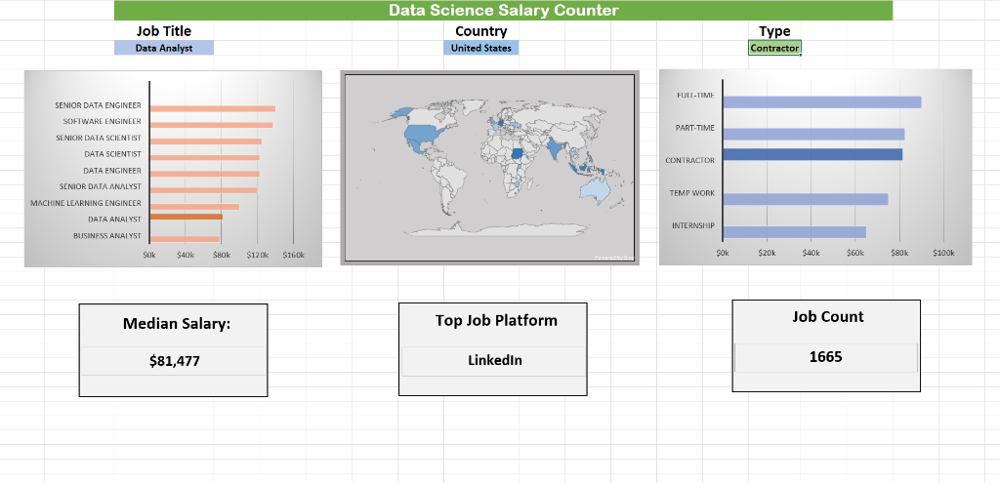

# Data Science Salary Counter & Interactive Excel Dashboard

[](https://www.microsoft.com/en-us/microsoft-365/excel)
[](#technical-architecture--excel-formulas)
[](#)
[](https://nawfatnahin.github.io)

An interactive, dynamic Excel analytics dashboard and salary intelligence model engineered to analyze global compensation, employment schedule types, and hiring platform distributions across the data science ecosystem.

---

## 📊 Dashboard Preview



---

## 🎯 Project Overview

Understanding salary expectations across tech and data science requires isolating multiple interdependent variables—such as specialization, geographic market, and employment engagement type (e.g., contractor vs. full-time). 

This project provides an intuitive, real-time business intelligence dashboard built entirely in Microsoft Excel. It empowers aspiring data analysts, engineers, and scientists to explore global compensation metrics and benchmark compensation against market realities.

### Key Insights Delivered
- **Dynamic Salary Benchmarking**: Evaluate median salaries across specific roles and countries.
- **Role Compensation Comparison**: Horizontal bar ranking visualizing median pay across 9 data roles (from Business Analyst to Senior Data Engineer).
- **Global Footprint**: Integrated choropleth map highlighting job distribution across North America, Europe, Asia, and worldwide markets.
- **Employment Type Variance**: Direct visual comparison of compensation across Full-time, Part-time, Contractor, Temporary, and Internship positions.

---

## 🎛️ Interactive Controls & KPI Cards

The dashboard operates via three synchronized input selectors on the `Calculator` sheet:

| Control | Description | Options / Behavior |
| :--- | :--- | :--- |
| **Job Title** | Primary role filter | Data Analyst, Data Scientist, Data Engineer, Senior Data Engineer, Machine Learning Engineer, Software Engineer, Business Analyst |
| **Country** | Geographic market selector | Global coverage (United States, United Kingdom, Canada, Germany, India, Sudan, etc.) |
| **Type** | Employment schedule selector | Contractor, Full-Time, Part-Time, Temp Work, Internship |

### Real-Time KPI Metrics
1. **Median Salary**: Calculates the robust median annual salary (`$81,477` in default view) rather than a skewed average, removing distortion from extreme compensation outliers.
2. **Top Job Platform**: Identifies the primary hiring portal yielding the highest frequency of matched job postings (e.g., *LinkedIn*, *ZipRecruiter*).
3. **Job Count**: Quantifies total verified job postings matching the active combination of role, region, and employment type.

---

## ⚙️ Technical Architecture & Excel Formulas

The workbook is structured into dedicated data layers and calculation engines, keeping the front-facing dashboard clean, fast, and responsive:

### 1. Multi-Condition Array Calculations
To calculate median compensation filtered across multiple non-contiguous criteria without helper column bloat, custom array formulas were developed:

```excel
=MEDIAN(
  IF(
    (jobs[job_title_short]=Title)*
    (jobs[salary_year_avg]<>0)*
    (jobs[job_country]=country)*
    (ISNUMBER(SEARCH($C2, jobs[job_schedule_type]))),
    jobs[salary_year_avg]
  )
)
```
*Utilizes boolean multiplication `(condition1) * (condition2) * ...` inside an array `IF` evaluation, ignoring zero or missing salary entries.*

### 2. Modern Dynamic Arrays
- **`UNIQUE()`**: Extracts distinct job platforms, country codes, and schedule categories without manual deduplication.
- **`FILTER()`**: Extracts subsets of job postings and platform frequencies dynamically based on active filter selections.
- **`SORT()`**: Automatically re-orders horizontal bar chart data in ascending/descending order for clean visual hierarchy.

### 3. Advanced Lookups & Text Normalization
- **`XLOOKUP()`**: High-speed, robust lookups replacing legacy `VLOOKUP` to map user selections to calculation sheets.
- **`SUBSTITUTE()` & `SEARCH()`**: Normalizes text strings (e.g., stripping `via ` prefixes from portal names such as `via LinkedIn` → `LinkedIn`).

---

## 📂 Repository Structure

```
├── assets/
│   └── dashboard_preview.png        # High-resolution dashboard screenshot
├── Data_Science_Salary_Counter.xlsx # Complete interactive Excel workbook
├── dashboard_preview.png            # Direct root preview asset
├── .gitignore                       # Excel temp file exclusions
└── README.md                        # Documentation and architecture guide
```

---

## 🚀 How to Run & Explore Locally

1. **Clone or Download the Repository**:
   ```bash
   git clone https://github.com/Nawfatnahin/data-science-salary-counter.git
   ```
2. **Open the Workbook**:
   - Open `Data_Science_Salary_Counter.xlsx` in **Microsoft 365**, **Excel 2021+**, or **Excel for the Web**.
   > *Note: Dynamic array formulas (`UNIQUE`, `FILTER`, `SORT`) and Bing Map charts require modern Excel versions.*
3. **Interact with the Dashboard**:
   - Navigate to the **`Calculator`** sheet.
   - Use the dropdowns in cells **C3** (Job Title), **I3** (Country), and **O3** (Type) to instantly update all charts, rankings, and KPI cards.

---

## 👤 Author

**Nawfat Huda Nahin**  
*Urban Planner, GIS Analyst & Data Science Explorer*  
Rajshahi University of Engineering & Technology (RUET)

- 🌐 **Portfolio**: [nawfatnahin.github.io](https://nawfatnahin.github.io)
- 🐙 **GitHub**: [@Nawfatnahin](https://github.com/Nawfatnahin)
- 💼 **LinkedIn**: [Nawfat Huda Nahin](https://www.linkedin.com/in/nawfat-huda-nahin/)
